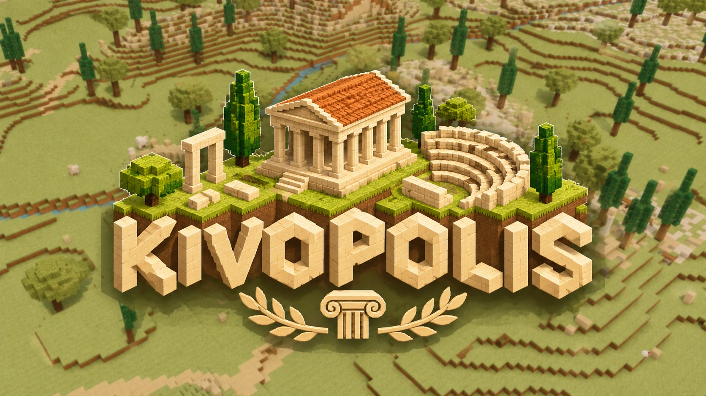

# KivoPolis



**KivoPolis** (from *κύβος*, cube, and *πόλις*, city) is a Greek-language browser game set on an island of ancient Greece. You build ancient buildings block by block and learn about them along the way. It can be played alone, or by up to five players in a shared room.

The island has four building areas, joined by an ancient road with bridges over a stream, boundary stones and a herm at the fork. Each building opens once the one before it is finished:

| Building | Area | Status |
| --- | --- | --- |
| **The theatre** | Theatre Valley, at the centre | Playable: nine steps |
| **The sanctuary of Dionysus** | A terrace south-west of the theatre, across the stream | Playable: eight steps, a Doric temple of 4 × 6 columns with its altar and boundary wall |
| **The agora** | The western plain, beyond the wooded ridge | Playable: boundary stones, a stoa of 7 Doric columns with 3 shops, a fountain house fed by a clay pipe from a spring, and market stalls |
| **The stadium** | A valley between low hills to the south-east | Playable: a sand track of 40 × 4 units with a starting line at each end, spectator banks, the judges' seats, a vaulted entrance, turning posts and a water channel fed from a spring; the game ends with a run down the track |

In the theatre you walk to the site marker, activate the blueprint, and build a fictional ancient Greek theatre in nine steps: the orchestra, the analemmata, four curved rows of seats split by a gravel diazoma, the stairways, the skene and the parodoi. The next phases are planned in [PLAN-buildings.md](PLAN-buildings.md).

Saved games are still stored under the `ancient-polis` name, so renaming the game keeps everyone's progress.

## Run locally

Use Node.js 22.12 or newer.

```sh
npm ci
npm run dev
```

Open the local URL printed by Vite in a browser with WebGL 2.

## Play

| Action | Desktop | Touch |
| --- | --- | --- |
| Walk, jump, crouch | WASD or arrow keys. Shift to walk faster, Space to jump, C to crouch. | Hold a directional button or the jump button. |
| Look around | Click the world to lock the mouse, then move it (Esc releases). Dragging also works. | Drag the scene. |
| Break a block | Hold the left button on the outlined block. | Hold the pickaxe button. |
| Place a block | Right-click a block face. Pick the block with 1–9 or the scroll wheel. | Tap the + button. Tap a hotbar slot to pick. |
| First/third person | Press V. | — |
| Backpack and crafting | Press E (away from the signposts) for a 2 × 2 crafting grid. Right-click a workshop for 3 × 3, or a kiln to fire clay and smelt ore. Q drops the held item. | Tap the backpack button. |
| Discover the blueprint or start the final tour | Approach the marker and press E. | Approach the marker and tap the interaction button. |
| Overview camera (Σχέδιο) | Press B or use the mode button; the eye button shows the whole plan. | Tap the mode button. |
| Orbit, pan, and zoom in the overview | Drag, Shift-drag, and scroll. | Drag to orbit and pinch to zoom. |
| Fly (creative only) | Double-tap Space; Space rises, C sinks, touch the ground to land. | Double-tap the jump button. |
| Animals | Hit a sheep for wool, right-click a goat for milk; chickens drop feathers. | Pickaxe button on a sheep, + on a goat. |

The theatre is built block by block in first person, like any other build. There are no prefab pieces. After the plan is activated at the site sign, the current mission's blocks appear as glowing ghost blocks. A correct block placed in a ghost cell counts towards the mission, and a block that does not belong there is outlined in red. Breaking a block is the undo. The mission card lists the materials still needed next to how many the player carries. The blueprint is 642 blocks:
- **Orchestra (48):** an ashlar ring set flush into a trench, and an altar base (the thymele).
- **Analemmata (114):** the two ashlar retaining walls that close the koilon at its sides.
- **First seats (64):** the two marble rows of the lower tier, starting with the prohedria.
- **Diazoma (94):** a level gravel walkway between the lower and upper tiers.
- **Koilon (100):** the two marble rows of the upper tier.
- **Stairs (74):** the two marble aisle staircases that split the seats into three kerkides.
- **Skene (122):** ashlar platform and walls, olive-log posts and a terracotta roof.
- **Gates (26):** two ashlar parodos gateways with marble lintels.

Three ways to play, chosen when a game starts and switchable in settings:
- **Συλλογή υλικών (gathering):** cut wood, craft tools and dress stone before building. A «Πρώτα βήματα» guide walks through the first steps.
- **Επιβίωση (survival):** gathering, with health and hunger. A fall of more than 3 blocks costs a point for every block beyond. Hunger falls as you go about; health comes back slowly only while you are fed, and an empty stomach wears it down to its last point. Eat with the place button: olives (from olive leaves), figs (from fig trees), milk (from goats) and bread (3 wild wheat make dough, which the kiln bakes). A player whose health runs out faints and wakes with full health, keeping everything: on their κλίνη, if they have lain on one (a feather, 2 wool and 3 planks at the workshop), or else at the theatre. Health and hunger are shown above the hotbar and belong to each player; in a room, the room keeps them, with the bed, for the player's return.
- **Δημιουργικό (creative):** every item in the backpack palette, instant breaking, blocks that never run out, and flight. Meant for classrooms.

Water placed above sea level is a source: it runs down and spreads up to seven blocks sideways, and dries up when its source is taken away. A hydria (three terracotta blocks at the workshop) carries water from one place to another.

Day turns to night over 20 minutes. Oil lamps («Λυχνοστάτης»: a clay lump on a stick) light their surroundings, and sheep, goats and chickens roam the meadows. Short history notes pop up in the top-right corner the first time night falls, a lamp is lit or an animal is met, and they are kept in the journal. The day cycle can be switched off in settings.

Progress and settings are saved automatically in the browser (IndexedDB). The save (version 3) keeps the shared game (buildings found and finished, history notes, time of day, the way of playing), this player's position, health, hunger and inventory, the device settings, and the world edits chunk by chunk. Mission progress, knowledge points and the tour are derived from the blocks in the saved world. Older saves are upgraded once: LocalStorage saves move into IndexedDB, saves from the smaller first island move onto the larger grid with the theatre in place, and saves from the prefab era fill the blueprint cells of the pieces they had placed. The pause menu can restart the current mission, which takes its blocks down and returns them to the inventory. Settings offers a confirmation dialog before resetting the campaign.

## Play with friends

With the room server running, the start menu shows «Παιχνίδι με φίλους». One player creates a room and shares its six-character code; up to four more join with the code and a nickname. Everyone builds in the same world and shares the progress, the water, the animals, the dropped items and the kilns. Because the players are children, there is no free text chat: nine preset phrases (T, then 1–9) and a pointer (G) that marks a block for everyone. Only the room's creator can restart a step, switch creative or survival play, or remove a player. No accounts, e-mail or personal data are collected, and nothing is sent to third-party services. Setting up the server is described in [server/README.md](server/README.md).

## Build and deploy

```sh
npm run build
npm run preview
```

Deploy the contents of `dist/` to any static web host. For Netlify or Vercel, use `npm run build` as the build command and `dist` as the output directory. Playing alone needs no server. For rooms, set `VITE_ROOM_SERVER` (for example `wss://rooms.kivopolis.com`) in the build environment; without it the multiplayer button is hidden.

## Verify

```sh
npm test
npx playwright install chromium
npm run test:e2e
```

Vitest covers the theatre blueprint, block-counted mission progress, old-save migration, the voxel world (generation, edits and persistence, meshing, raycasts, physics), items (recipes, mining, inventory moves, tool wear, kiln smelting), flowing water, the island (theatre valley unchanged, shore, building areas, bridges, a walkable road), progress per building, the shared game record, and the room server's rules. Playwright activates the plan and lays an orchestra block in first person, upgrades an old save into a finished theatre and runs the tour, walks the road from the theatre to the sanctuary's signpost, checks the blueprint guide on a phone, exercises the break, pick up and place loop, and plays two browsers in one room (`tests/rooms.e2e.ts`).

`npm run load-check` starts a room server and fills 10 rooms with 5 simulated players each, then reports message rates and round-trip times. Point it at a deployed server with `LOAD_URL=wss://rooms.kivopolis.com` (and an `Origin` the server allows, through `LOAD_ORIGIN`).

## Project layout

- `src/game/theatre.ts` defines the objectives, markers and row geometry. `src/game/blueprints/theatre.ts` is the voxel blueprint, and `src/game/site.ts` counts built cells from the world.
- `src/game/buildings.ts` keeps the buildings' opening order and per-building progress; `src/game/regions.ts` lays out the island: the areas, the stream, the road, the ridge and the hills.
- `src/game/shared.ts` holds the shared game, `src/game/store.ts` this player's state and the device settings, and `src/game/save.ts` the IndexedDB save and its upgrades. `src/game/actions.ts` applies every player change through one function, in single-player and in rooms.
- `src/game/items.ts`, `recipes.ts` and `inventory.ts` define items and tools, mining rules, crafting recipes, the 36-slot inventory, and kiln smelting.
- `src/game/terrain.ts` defines the design heightfield and island edge that the voxel generator samples.
- `src/voxel/` holds the block world: block registry, 384 × 48 × 384 grid (0.5-unit blocks), island generator, flowing water (`flow.ts`), face-culled AO mesher, DDA raycast, and player AABB physics.
- `src/net/` is the room client: messages, joining, and keeping the game in step with the room. `server/` is the room server (see [server/README.md](server/README.md)).
- `src/game/el.ts` contains the Greek interface and journal text.
- `src/world/` renders the terrain, blueprint ghosts (`SiteGuide.tsx`), drops and block interaction, and handles the camera and input.
- `src/ui/` contains the HUD, inventory, and dialogs.

The theatre is a fictional educational interpretation. After the tour, the completion screen points along the road to the sanctuary of Dionysus. Historical references include the [Hellenic Ministry of Culture's ancient theatre educational programme](https://ancienttheater.culture.gr/en/), the [Ephorate of Antiquities of Phocis's description of Delphi's theatre](https://www.e-delphi.gr/en-gb/site/monuments/thetheatre.aspx), and the [Metropolitan Museum of Art's essay on Greek theatre](https://www.metmuseum.org/essays/theater-in-ancient-greece).
